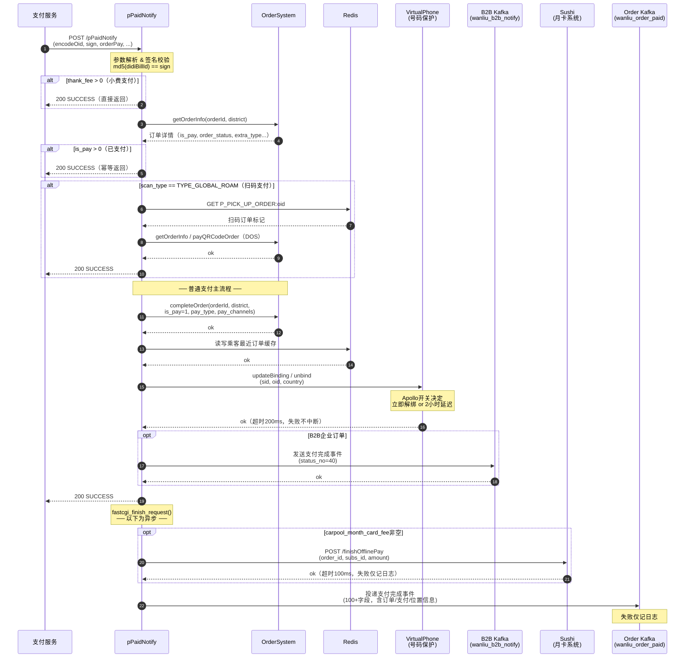

# pPaidNotify 接口分析

## 一、功能作用简介

`pPaidNotify` 是乘客侧**支付结果回调接口**，由支付服务在用户完成支付后主动调用。

其核心职责是：
- 将订单状态从「未支付」更新为「已支付」
- 触发支付完成后的一系列下游联动（号码保护解绑、企业订单通知、数据同步等）

接口路由：`/gulfstream/passenger/v2/core/pPaidNotify`

---

## 二、调用场景

| 场景 | 触发方 | 说明 |
|------|--------|------|
| 普通行程支付 | 支付服务 | 用户对完成订单/取消订单完成付款 |
| 全球漫游扫码支付 | 支付服务 | `scan_type = TYPE_GLOBAL_ROAM`，扬招扫码付款 |
| 小费支付 | 支付服务 | `thank_fee > 0`，单独小费支付，**快速返回不走主流程** |
| 企业支付 | 支付服务 | `business_pay_type != 0`，由企业账户代付 |
| 共乘月卡支付 | 支付服务 | `carpool_month_card_fee` 非空，包含月卡抵扣 |

---

## 三、核心流程

### 3.1 主流程图

```
支付服务
    │
    ▼
[参数解析 & 签名校验]
    │  md5(didiBillId) == sign
    │
    ├─► [小费支付？thank_fee > 0]
    │        └─► 直接返回 SUCCESS（不更新订单）
    │
    ▼
[加载订单信息]  ← OrderSystemRpc::getOrderInfo()
    │
    ├─► [订单已支付？is_pay > 0]
    │        └─► 返回 SUCCESS（幂等保护）
    │
    ├─► [全球漫游扫码？scan_type == TYPE_GLOBAL_ROAM]
    │        └─► PScanPayLogic::scanPay()
    │             ├── Redis 确认是扬招扫码订单
    │             ├── DOS 获取订单信息
    │             └── DOS 更新支付状态
    │                  └─► 返回 SUCCESS
    │
    ▼
[完成订单]  ← OrderSystemRpc::completeOrder()
    │  验证订单状态（已完成/已取消等），写入 is_pay=1
    │
    ▼
[更新乘客最近订单缓存]  ← Redis
    │
    ▼
[解绑虚拟号码保护]  ← VirtualPhoneRpc
    │
    ▼
[企业订单通知]  ← Kafka(wanliu_b2b_notify)（B2B 订单才执行）
    │
    ▼
◄── 返回 SUCCESS（fastcgi_finish_request，此后为异步）
    │
    ▼
[月卡支付状态同步]  ← SushiRpc（含月卡时执行）
    │
    ▼
[Kafka 同步支付事件]  ← Kafka(wanliu_order_paid)
```

### 3.2 调用时序图



### 3.3 同步 vs 异步边界

| 阶段 | 执行方式 | 失败影响 |
|------|---------|---------|
| 参数校验、订单加载、completeOrder | 同步，任一失败中断 | 直接返回错误 |
| 虚拟号解绑、企业通知 | 同步，但异常不中断 | 仅日志记录 |
| 月卡同步、Kafka 投递 | `fastcgi_finish_request` 后执行 | 不影响响应，失败仅记日志 |

---

## 四、核心关键参数

### 4.1 请求参数

| 参数 | 类型 | 说明 |
|------|------|------|
| `encodeOid` | string | 加密的订单 ID |
| `didiBillId` | string | 支付系统账单 ID |
| `sign` | string | 签名，值为 `md5(didiBillId)` |
| `orderPay` | JSON | 支付信息（金额、渠道、时间等） |
| `orderResult` | JSON | 支付结果明细 |
| `thank_fee` | int | 小费金额，>0 时走小费快速路径 |
| `scan_type` | int | 扫码类型，`TYPE_GLOBAL_ROAM` 走扫码路径 |
| `business_pay_type` | int | 企业支付类型，非 0 时代替订单原始支付类型 |
| `actual_pay_fee` | string | 实际支付金额，透传至 Kafka |
| `carpool_month_card_fee` | int | 月卡抵扣金额，触发月卡同步 |

### 4.2 核心内部状态字段

| 字段 | 来源 | 作用 |
|------|------|------|
| `is_pay` | 订单系统 | **幂等核心**，>0 代表已支付 |
| `order_status` | 订单系统 | 决定是否允许执行 completeOrder |
| `extra_type` | 订单系统 | 包含 `o_protect` 标签，决定是否解绑号码 |
| `country_iso_code` | 订单系统 | 决定虚拟号解绑策略（立即 or 延迟） |

---

## 五、核心下游依赖

### 5.1 OrderSystemRpc — 订单系统

**调用时机：** 流程前期（同步必须成功）

**做了什么：**

1. `getOrderInfo()` — 读取订单详情，获取 `is_pay`、`order_status`、`extra_type` 等字段，作为后续所有判断的数据基础。

2. `completeOrder()` — **最核心的写操作**，向订单系统写入支付完成状态，更新 `is_pay=1`、`pay_type`、`pay_channels`。这一步决定订单是否真正被标记为「已支付」，一旦成功，整个支付流程在业务上即告完成。

### 5.2 VirtualPhoneRpc — 号码保护系统

**调用时机：** completeOrder 成功后（同步，失败不中断）

**做了什么：**

支付完成后，乘客与司机之间的行程结束，不再需要保护双方真实手机号，因此需要解除之前绑定的虚拟中间号。

- 若 Apollo 开关允许当前国家立即解绑 → 调用 `/mp/axb/api/unbind/` 立即解除；
- 否则 → 调用 `/mp/axb/api/updateBinding/?expiration=...` 设置 2 小时后自动过期。
- 特殊情况：若是**国际化代叫订单**（`is_callcar=1`），实际乘车人的号码也需要单独解绑；若是**闪送订单**，收件人号码也一并处理。

> 目标服务：`disf!common-plat-public-axb-api`，超时 200ms。

### 5.3 SushiRpc — 共乘月卡系统

**调用时机：** 异步（fastcgi_finish_request 之后）

**做了什么：**

当订单包含共乘月卡抵扣（`carpool_month_card_fee` 非空）时，通知月卡订阅系统本次线下支付已完成，触发月卡核销扣减。

- 接口：POST `/isr/sushi/subs/finishOfflinePay`
- 传入订单号、订阅 ID、月卡抵扣金额
- 超时 100ms，失败仅记日志

### 5.4 Kafka — wanliu_order_paid（数据大盘 / 下游业务订阅）

**调用时机：** 异步（fastcgi_finish_request 之后）

**做了什么：**

将支付完成事件投递到 Kafka，供数据仓库、风控、营销等多个下游系统消费。消息包含 100+ 字段，涵盖：

- 订单基础信息（订单号、乘客、司机、城市）
- 支付信息（金额、渠道、时间）
- 费用明细（成本费用从 channel=110 提取）
- 位置信息（GPS 坐标）
- 乘客应用版本、呼叫次数等行为数据

> Topic：`wanliu_order_paid`，消息类型 40200。失败不中断主流程。

### 5.5 Kafka — wanliu_b2b_notify（企业业务通知）

**调用时机：** 同步，completeOrder 之后

**做了什么：**

仅当订单属于 B2B 企业渠道时触发，向企业通知系统发送「乘客侧支付完成」事件（状态码 40），使企业后台系统（如差旅系统）感知该订单已结算。

### 5.6 Redis — 乘客最近订单缓存

**调用时机：** completeOrder 成功后（同步）

**做了什么：**

维护乘客「最近未支付订单」的缓存标记。支付完成后，若当前订单正是缓存中的最近订单，则从多订单列表中找到下一个未支付订单更新缓存，或直接清空。

> 主要用于前端「继续支付」入口的状态展示。

---

## 六、接口问题及风险识别

### 6.1 幂等窗口（中风险）

**问题：** 幂等控制依赖从 OrderSystem 读取的 `is_pay` 字段。但从「读取到 is_pay=0」到「completeOrder 写入 is_pay=1」之间存在时间窗口。若支付服务在此期间并发回调，两个请求都可能通过幂等检查并同时执行 `completeOrder`。

**现状：** 依靠 OrderSystem 内部保证写操作的原子性，但 passenger-deal 层无额外锁保护。

**建议：** 在 passenger-deal 侧增加 Redis 分布式锁，以 `order_id` 为 key，锁定整个 completeOrder 操作。

---

### 6.2 Kafka 消息与订单状态不一致（中风险）

**问题：** `completeOrder`（写订单系统）成功后，Kafka 消息投递是异步的，且失败只记日志不重试。若 Kafka 投递失败，订单已标记支付但下游数据仓库、风控等无感知。

**建议：** 引入本地消息表或至少增加失败告警，确保 Kafka 消息最终可追溯重投。

---

### 6.3 硬编码 API Key（低风险 / 合规问题）

**问题：** `sushiRpc.php:15` 中 Sushi 的 `api-key` 直接硬编码为 JWT 字符串。

**建议：** 迁移至配置中心（Apollo / 环境变量）统一管理。

---

### 6.4 扫码订单与普通订单流程割裂（低风险）

**问题：** 全球漫游扫码支付（`scan_type == TYPE_GLOBAL_ROAM`）走完全独立的分支后直接 return，不经过 completeOrder、虚拟号解绑、Kafka 同步等步骤。若扫码场景也需要这些后置动作，当前代码会产生遗漏。

**建议：** 梳理扫码订单的完整需求，明确是否需要复用普通支付的后置逻辑。

---

### 6.5 月卡超时极短（低风险）

**问题：** SushiRpc 超时设置为 100ms，在网络抖动或 Sushi 服务压力较大时极易超时，导致月卡状态无法同步。

**建议：** 评估 Sushi 的实际 P99 响应时间，适当放宽超时，或改为异步队列重试机制。

---

### 6.6 优惠券信息更新被注释（低风险 / 待确认）

**问题：** `CommonPaidNotifyLogic.php:85-86` 中 `updateCouponInfo()` 被注释，不确定是临时下线还是已废弃。

**建议：** 确认该逻辑去向，若已迁移至其他系统则清理注释代码，避免引发误解。
